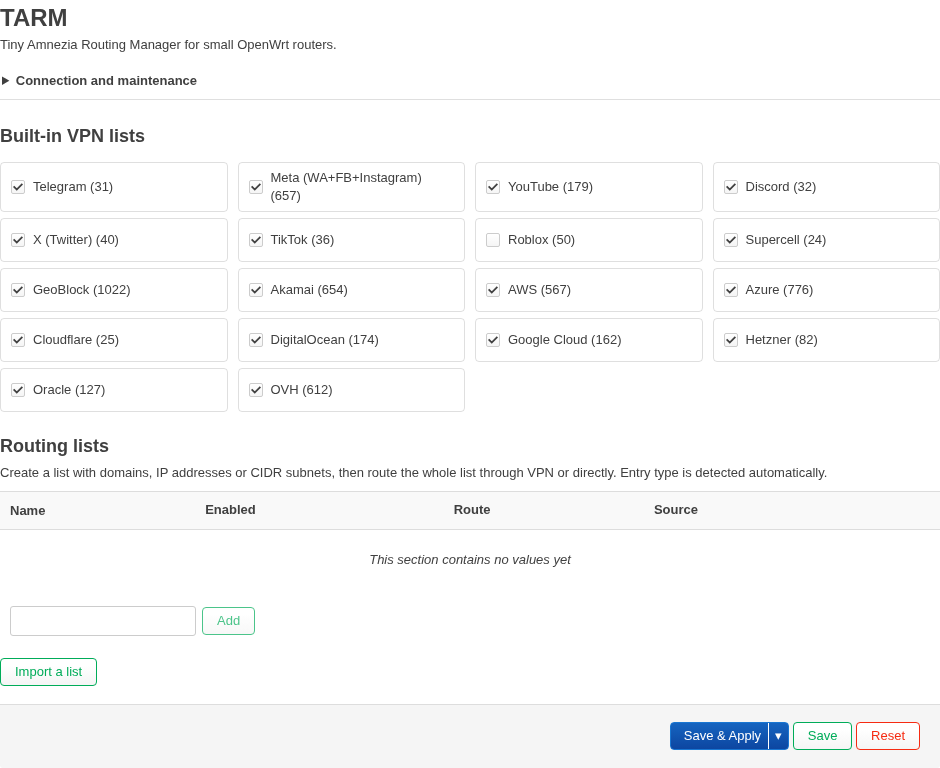
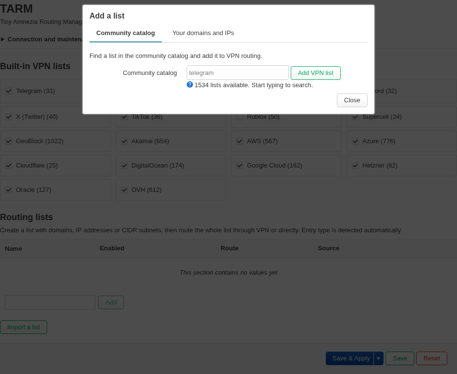
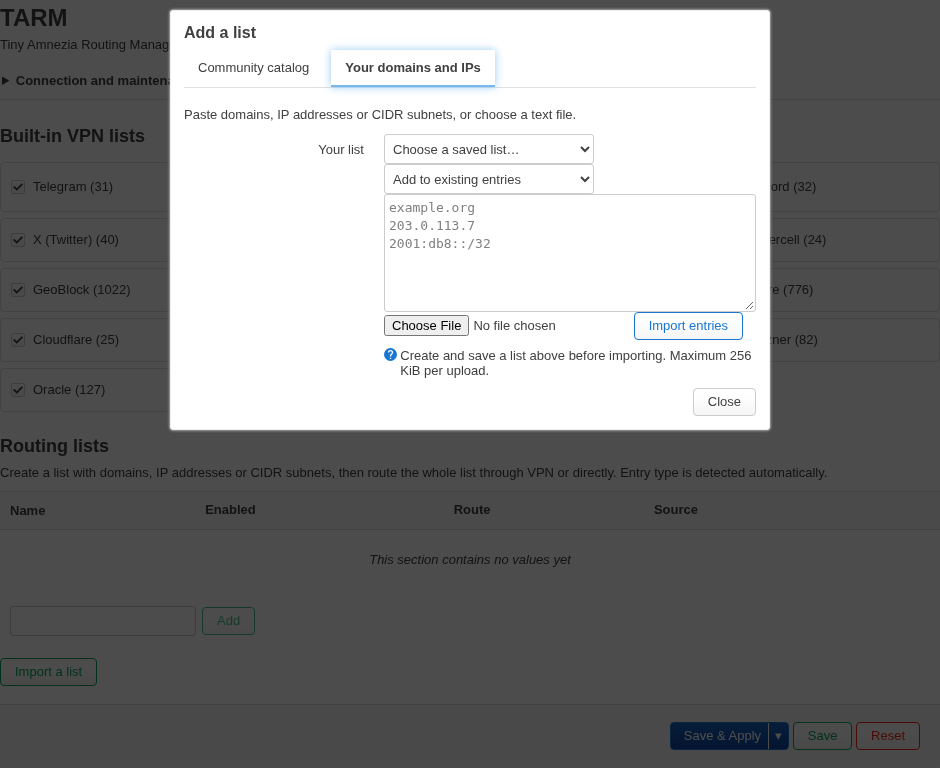

# TARM — Tiny Amnezia Routing Manager

[Русский](README.md) · **English**

TARM is a small AmneziaWG client for OpenWrt with routing by domain, IP address, and CIDR subnet. Tunnel configuration and routing lists are managed in one LuCI app and CLI. It uses `dnsmasq-full`, nftables, and policy routing; it does not need a separate DNS proxy.

Version 0.6.0 targets small routers such as the Xiaomi Mi Router 4C (MT7628, 16 MB flash, 64 MB RAM). The OpenWrt 24.10.8 and 25.12.5 packages have both been tested on a physical 4C. The 24.10.8 installation left 7.1 MiB free in the overlay.

## Interface

These screenshots were taken on a Xiaomi Mi Router 4C running OpenWrt 24.10.8. The tunnel configuration is collapsed.



Import from the community catalog:



Import your own domains, IP addresses, and subnets:



## How routing works

`dnsmasq-full` puts resolved addresses for selected domains into nft sets. LAN packets to those addresses receive mark `0x700000` and use table 700 through `awg0`. A blackhole route protects marked traffic when the tunnel is unavailable. Ordinary `apply` operations keep the policy rule in place. Nft rules and static sets change in one transaction, while dynamic DNS sets remain intact. Connection marks are stored in conntrack. The tunnel's own UDP packets carry a separate `socket_mark` so they do not loop back into the tunnel.

LuCI lets you create named lists that mix domains, IPv4, IPv6, and CIDR subnets. Domains go through `dnsmasq`; literal addresses and subnets go directly into nftables. A whole list can use the VPN or a direct route. Direct lists take priority when IP rules overlap. Lists may also have an HTTPS subscription. Updates run daily or on demand, have a download size limit, and keep the previous file if a download fails.

If you set a VPN DNS server, selected domains are resolved through that server inside the tunnel. Otherwise, they use the ordinary `dnsmasq` upstream servers.

## AmneziaWG kernel patch

The package includes a [small patch](kmod-amneziawg/patches/100-uniprocessor-rx-budget.patch) to the AmneziaWG kernel module. On kernels built without `CONFIG_SMP`, the first eight incoming packets in each `jiffy` are decrypted in the receive context instead of being handed to the shared crypto workqueue. Packets still pass through their peer queue and NAPI, preserving receive order. Additional packets in the same `jiffy` take the module's normal queued path.

On the single-core MT7628, this avoids some worker scheduling for light incoming traffic. The eight-packet budget limits work in the receive context; processing then returns to the normal queue. The patch does not change the wire format, obfuscation parameters, keys, or AmneziaWG server compatibility. Its code is not compiled on `CONFIG_SMP` kernels. It has been exercised on the Xiaomi 4C; there is no controlled speed comparison against the unpatched module yet.

## Installation

You need `tarm`, `luci-app-tarm`, `amneziawg-tools`, and the patched `kmod-amneziawg`. The kmod's full `kernel` dependency must match your running OpenWrt kernel ABI. A custom firmware image with a different ABI needs a kmod built from the same OpenWrt tree.

Packages for official OpenWrt 24.10.8 `ramips/mt76x8` are in [`dist/openwrt-24.10.8-ramips-mt76x8/`](dist/openwrt-24.10.8-ramips-mt76x8/) (`.ipk`, `opkg`). Packages for official OpenWrt 25.12.5 on the same target are in [`dist/openwrt-25.12.5-ramips-mt76x8/`](dist/openwrt-25.12.5-ramips-mt76x8/) (`.apk`, `apk`). Check the complete kernel ABI, not just the OpenWrt version number.

Check free overlay space, copy all four matching packages to `/tmp` on the router, and install them. On 25.12.5:

```sh
df -h /overlay
apk update
apk add --allow-untrusted /tmp/kmod-amneziawg-6.12.94.3.1.20260812-r3.apk /tmp/amneziawg-tools-3.1.20260812-r1.apk /tmp/tarm-0.6.0-r8.apk /tmp/luci-app-tarm-0.6.0-r10.apk
```

On a clean 24.10.8 image, the base `dnsmasq` conflicts with the required `dnsmasq-full` because both own the same files. Replace it during installation:

```sh
opkg update
opkg remove dnsmasq
opkg install /tmp/kmod-amneziawg_*.ipk /tmp/amneziawg-tools_*.ipk /tmp/tarm_*.ipk /tmp/luci-app-tarm_*.ipk
```

There is no automatic installer yet. Verify the ABI and choose the package set manually.

To migrate an existing `awg-route` setup, copy `/etc/config/awg-route` to `/etc/config/tarm` and `/etc/awg-route` to `/etc/tarm`. Update any paths to custom list files in the new config. Install TARM, run `tarm check whatsapp.com` and `tarm apply`, then remove the old packages with `apk del --no-scripts --no-commit-hooks luci-app-awg-route awg-route`. Remove old cron entries and `awg-route.nft` / `awg-route.conf` files, then run `tarm apply` again. Keep the old configuration as a backup. The internal nft table is still named `awg_route`, allowing DNS addresses already in that table to survive the package rename.

The app packages are small; `dnsmasq-full`, `ip-full`, nftables, AmneziaWG, and their dependencies use most of the space. On a virtual OpenWrt 25.12.5 installation, the main installed packages measured about 414, 504, 781, 81, and 114 KiB respectively. Libraries and kernel modules need additional space. Roughly 9 MiB of free overlay was enough for our trial installation, but actual use depends on the firmware and other installed packages.

Open **Services → TARM** after installation. Paste a normal AmneziaWG text configuration with `[Interface]`, `[Peer]`, and `Address`. Under **Routing lists**, create a list, add domains, IP addresses, or subnets, select **VPN**, and enable it. Enable routing and press **Save & Apply**. For exceptions, create another list with **Direct** routing. TARM accepts the obfuscation fields supported by the installed `awg`, including `Jc`, `Jmin`, `Jmax`, `S1`–`S4`, and `H1`–`H4`. It does not execute `PreUp`, `PostUp`, `PreDown`, or `PostDown` script hooks.

**Built-in VPN lists** contains 18 local groups from a user-provided `.mtrickle` export dated 10 October 2026. Each group has its own checkbox. They are disabled by default so a 64 MB router does not load thousands of rules unnecessarily. Enabled rules from the export were preserved and overlapping subnets were merged without changing coverage. Four single-word entries (`youtube`, `imdb`, `intel`, `playstation`) were omitted because TARM supports dotted domains, IP addresses, and CIDR; the corresponding `.com` domains are already present. [`tools/build-mtrickle-presets.py`](tools/build-mtrickle-presets.py) regenerates the preset files.

**Import a list** can search [v2fly/domain-list-community](https://github.com/v2fly/domain-list-community) and create a VPN list. For `telegram`, TARM adds a snapshot of the [official Telegram IP ranges](https://core.telegram.org/resources/cidr.txt) because its apps may connect directly by IP. For `whatsapp`, it adds a snapshot of 108 Meta subnets from the supplied `.mtrickle` export; those subnets also route other Meta services through the VPN. This snapshot does not update with the domain catalog. You can also paste multiple domains, IPs, and subnets or upload a `.txt` file. Create and save a named list first, then import into it. The upload limit is 256 KiB per file and the final list limit is 1 MiB.

Pick one source for a topic: a built-in checkbox or an online catalog list. Duplicate entries are merged during `apply`, but downloading the same list adds no value. Catalog imports follow nested `include:` rules. They skip `full:`, `keyword:`, `regexp:`, and single-word names because TARM only handles domains with their subdomains. A catalog import is therefore not always identical to the original geosite list. Limits are 128 included files and 2 MiB total download.

Quick CLI example:

```sh
tarm import /tmp/client.conf
uci set tarm.main.enabled=1
uci set tarm.streaming=list
uci set tarm.streaming.enabled=1
uci set tarm.streaming.route=vpn
uci add_list tarm.streaming.domain='example.org'
uci add_list tarm.streaming.domain='203.0.113.7'
uci add_list tarm.streaming.domain='2001:db8::/32'
uci commit tarm
tarm apply
tarm check www.example.org
tarm status
tarm catalog-add telegram
cp /tmp/domains.txt /etc/tarm/import.txt
tarm import-list streaming append
```

An optional subscription in `/etc/config/tarm`:

```text
config list 'streaming'
    option enabled '1'
    option route 'vpn'
    list domain 'example.org'
    list domain 'video.example.net'
    list domain '203.0.113.7'
    list domain '2001:db8::/32'
    option url 'https://example.org/domains.txt'
```

Subscriptions accept one domain, address, or subnet per line; `#` starts a comment, and a leading dot is allowed. Legacy `vpn_domain`, `direct_domain`, `vpn_file`, and `direct_file` fields in the `main` section still work, but LuCI creates named lists for new entries.

## Testing and limitations

QEMU tests cover installation, reboot, subscriptions, direct exceptions, DNS population of nft sets, and routing with the interface up or down. Two virtual OpenWrt 25.12.5 systems running AmneziaWG 3.1 established a handshake and carried ICMP, including obfuscation parameters. On a physical Xiaomi 4C with 25.12.5, we tested LuCI saves, invalid-config errors, and the tunnel. On 24.10.8, we tested the handshake, ICMP through `awg0`, an HTTP 200 response from `telegram.org` via a LAN client with increasing AWG counters, and tunnel startup after reboot. The restored Wi-Fi access point came up; a separate Wi-Fi client was not tested on 24.10.8.

Domain rules depend on DNS answers seen by `dnsmasq`. A client using its own DoH/DoT or connecting to an already known IP may bypass a domain rule; literal IP or CIDR rules work without DNS. Shared CDN addresses can affect multiple domains. Unlike MagiTrickle, TARM has no separate DNS proxy, per-answer TTL tracking, or CNAME-chain analysis. DNS-derived addresses stay in an nft set for up to an hour; manually specified addresses and subnets remain until the list changes. Established connections can retain their old conntrack mark, and retained DNS addresses can keep the previous policy until they expire. Table 700 is configurable in UCI; rule priorities 16999 and 17000 are currently fixed. After changing the mark, table number, or VPN DNS server, run `tarm stop` followed by `tarm apply`.

The list idea was inspired by [MagiTrickle](https://github.com/MagiTrickle/MagiTrickle). The tunnel uses [AmneziaWG](https://github.com/amnezia-vpn/amneziawg-linux-kernel-module).

TARM's own code is MIT-licensed. The patch in `kmod-amneziawg/patches/` follows GPL-2.0, like the [upstream kernel module](https://github.com/amnezia-vpn/amneziawg-linux-kernel-module).
